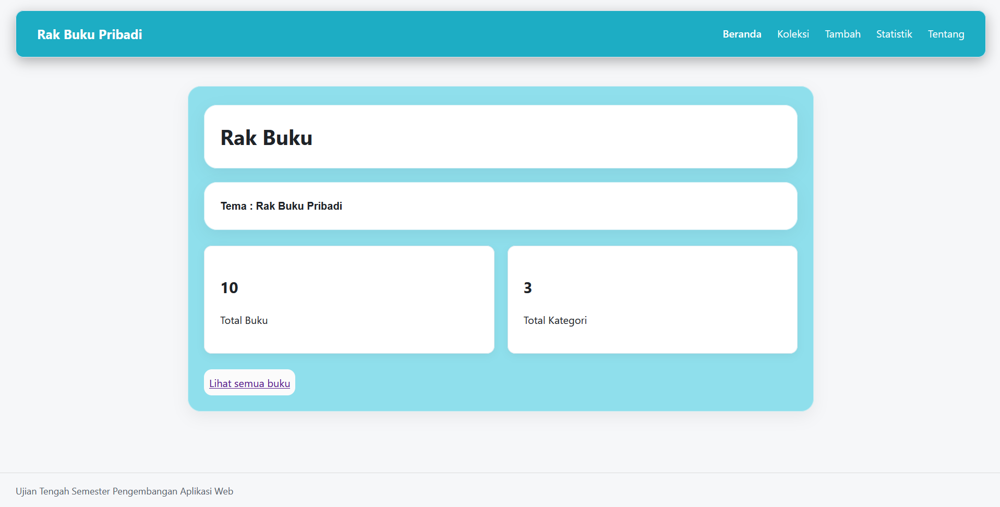
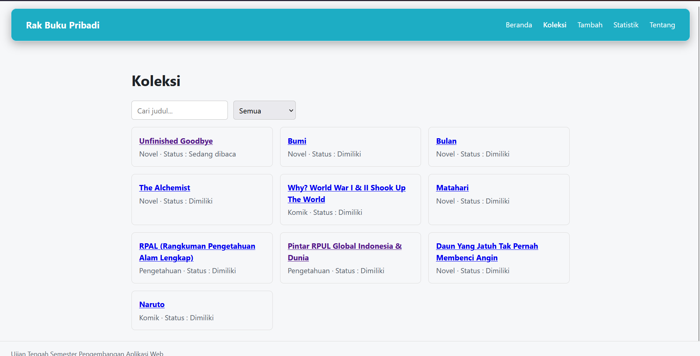
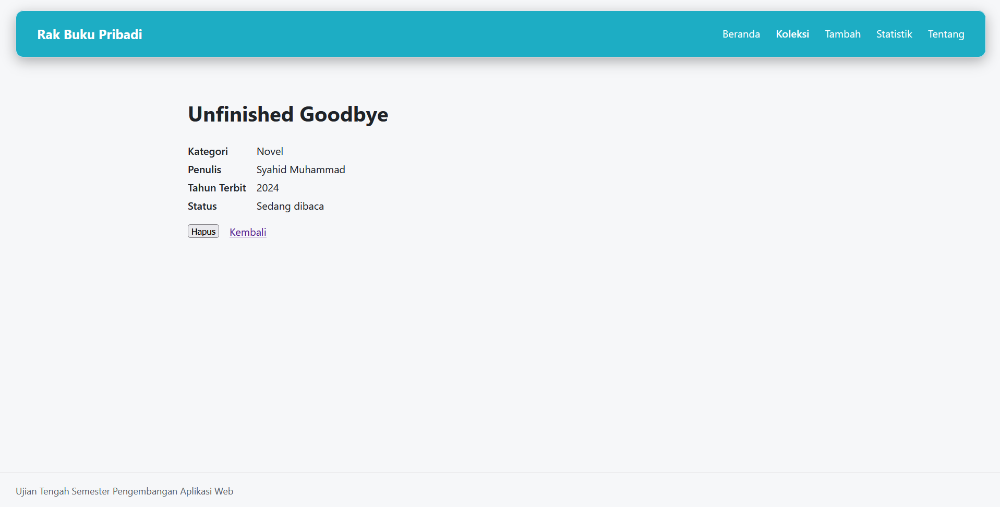
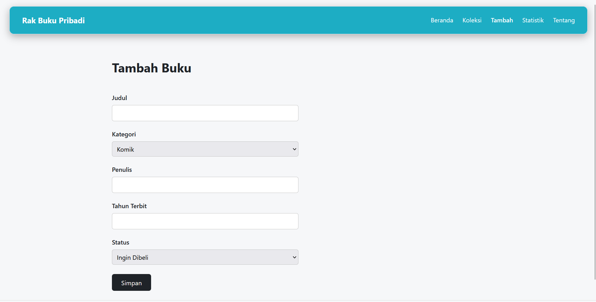
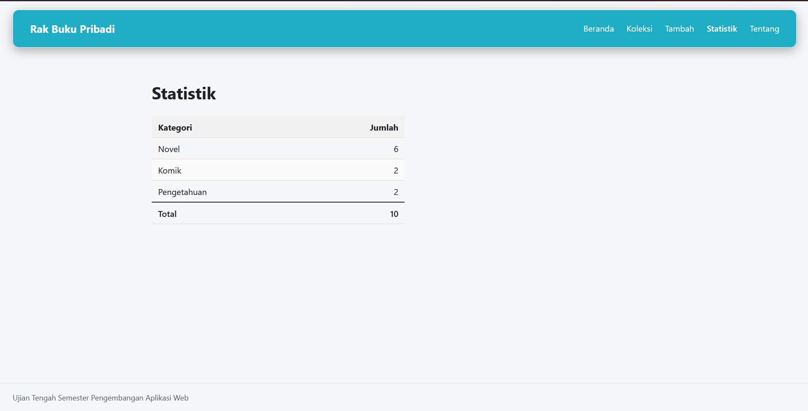
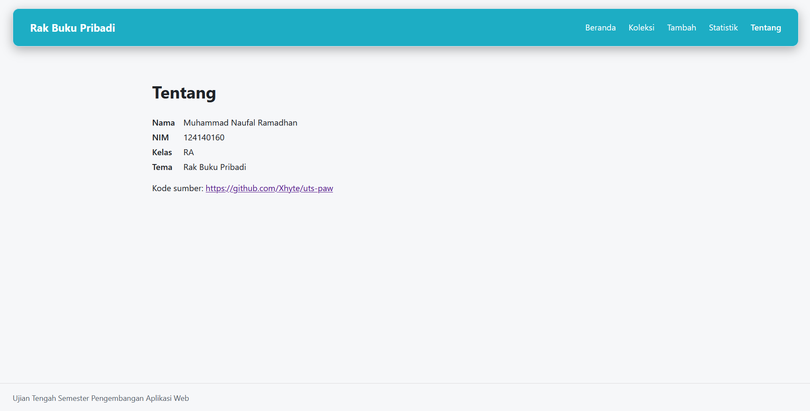
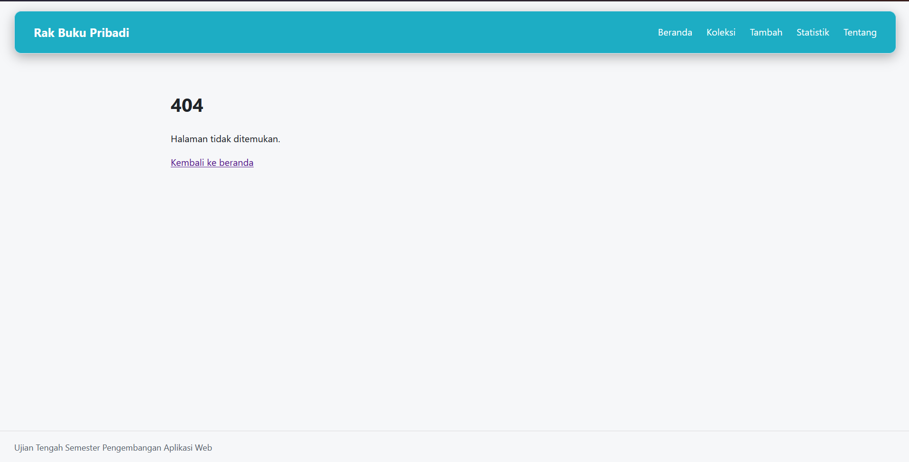

# Ujian Tengah Semester IF25-22014 Pengembangan Aplikasi Web

## README

# Rak Buku Pribadi

**Nama**: Muhammad Naufal Ramadhan  
**NIM**: 124140160  
**Kelas**: RA  
**Tema**: Rak Buku Pribadi  
**Deployment**: https://xhyte.github.io/uts-paw/  

### 1. Halaman beranda

### 2. Halaman Koleksi

### 3. Halaman Detail

### 4. Halaman Tambah

### 5. Halaman Statistik

### 6. Halaman Tentang

### 7. Halaman 404

## Fitur

- Beranda : Menampilkan ringkasan total buku dan kategori
- Koleksi : Menampilkan seluruh daftar buku, menu pencarian dan pengelolaan koleksi
- Tambah : Menampilkan formulir input untuk menambahkan buku
- Detail : Menampilkan informasi sebuah buku dengan lengkap
- Statistik : Menampilkan data jumlah koleksi buku per kategori beserta total keseluruhan
- Tentang : Menampilkan Identitas Mahasiswa
- Halaman 404 untuk alamat yang tidak dikena

## Menjalankan secara lokal

cd app  
npm install  
npm run dev  

## Konsep React yang dipakai

- Hooks dan custom hooks : Menggunakan kemampuan React state, context, dan efek samping. Membungkus logika yang dapat digunakan kembali (custom hooks)
- LocalStorage : Menyimpan koleksi buku di browser agar tidak hilang saat halaman di refresh
- React Router : Mengatur navigasi antar halaman tanpa memuat ulang seluruh website
- Props : Mengirim data dari komponen induk ke komponen anak
- Context : Membagikan data koleksi buku ke berbagai komponen tanpa harus mengirim props berulang kali

